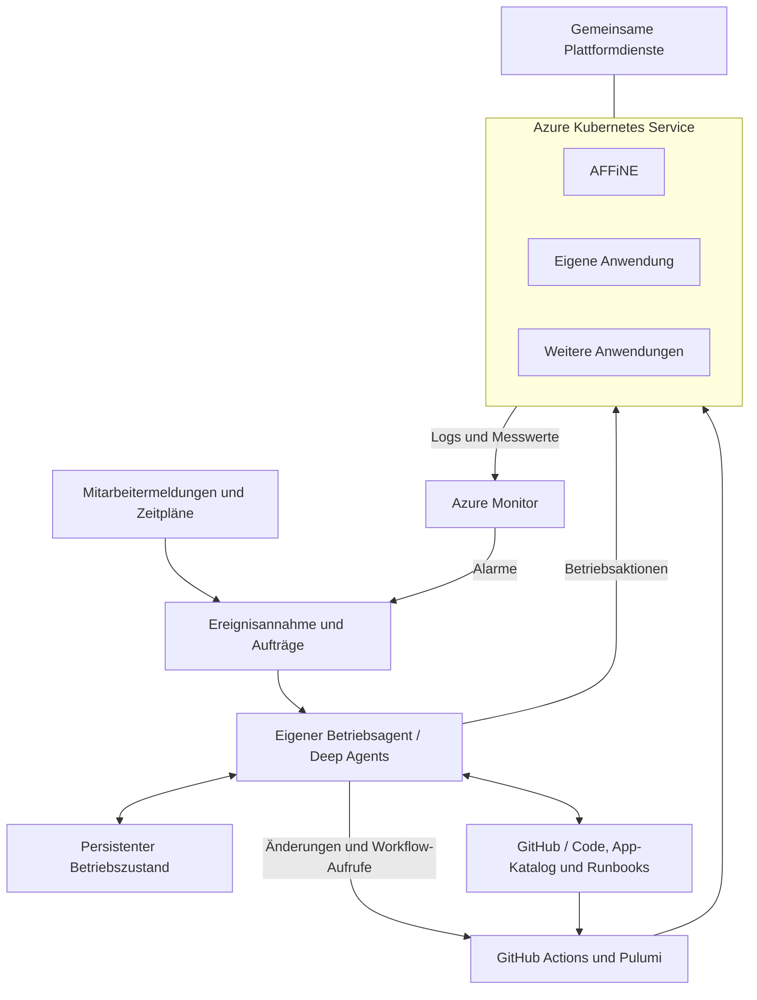

# Agentengestützte Plattform für selbst gehostete Anwendungen

Produktidee, Zielarchitektur und Implementierungsgrundlage für Phase 1

Stand: 30. Oktober 2026. Status: Entwurf für die Umsetzung, keine bereits implementierte Plattform.

## 1. Produktidee und Ausgangslage

Wir entwickeln eine interne Plattform, auf der MMK selbst entwickelte und bestehende Anwendungen auf Azure betreiben kann. Ein eigener Betriebsagent auf Basis des selbst gehosteten LangChain Deep Agents SDK unterstützt den Betrieb. Azure Kubernetes Service ist die gemeinsame Runtime. GitHub, GitHub Actions, Pulumi und Azure Monitor bilden die Grundlage für Code, Bereitstellung und Beobachtung.

Als IT-Beratung können wir mit AI Anwendungen schneller entwickeln und genauer an unsere Abläufe anpassen. Trotzdem kaufen wir SaaS, weil der laufende Betrieb eigene Kapazitäten bindet. Updates, Fehlerbehebung, Monitoring, Datenhaltung und Wiederherstellung können den Nutzen einer kleinen Eigenentwicklung wirtschaftlich aufzehren. Unsere Fachleute sollen möglichst viel Zeit in Kundenprojekten und Produktentwicklung verbringen können.

Die Plattform soll diese wiederkehrenden Betriebsaufgaben bündeln und automatisieren. Eine neue Anwendung übernimmt gemeinsame Deployment-, Monitoring- und Betriebsverfahren, statt dafür ein eigenes Betriebsprojekt aufzubauen. Der Agent verbindet eingehende Meldungen mit dem tatsächlichen Systemzustand, passenden Betriebsanleitungen und ausführbaren Werkzeugen.

Die wirtschaftliche Hypothese lautet: Wenn Entwicklung und wiederkehrender Betrieb weniger Handarbeit benötigen, werden mehr individuell passende Anwendungen wirtschaftlich. Ob dies zutrifft, messen wir an Gesamtaufwand und Gesamtkosten einschließlich Azure, Modellen, Plattformpflege und verbleibender manueller Arbeit. Eingesparte SaaS-Lizenzen allein sind kein ausreichender Erfolgsnachweis.

## 2. Zielbild und Nutzer

Die Plattform ist zunächst ein internes Produkt für MMK. Eine externe Vermarktung oder der Betrieb mehrerer Kundenorganisationen ist eine spätere Entscheidung.

Mitarbeitende verwenden die bereitgestellten Apps und melden Probleme über einen gemeinsamen Eingang. Entwickler veröffentlichen neue Anwendungen über eine standardisierte Pipeline. Plattformverantwortliche pflegen gemeinsame Bausteine und definieren Betriebsverfahren. Der Agent bearbeitet eingehende Aufgaben und dokumentiert seine Ergebnisse.

Langfristig umfasst das Produkt den gesamten Lebenszyklus einer aufgenommenen Anwendung:

- Registrierung und Erstbereitstellung.
- Veröffentlichung neuer Versionen und Anpassung der Infrastruktur.
- Überwachung von Verfügbarkeit und fachlicher Funktion.
- Bearbeitung von Störungen und Mitarbeitermeldungen.
- Geplante Updates und Wartungsaufgaben.
- Sicherung, getestete Wiederherstellung und geordnete Außerbetriebnahme.

Routinefälle sollen ohne manuelle Freigabe ablaufen können. Fälle ohne nachweisbare Lösung bleiben sichtbar offen. Der Agent darf einen Vorfall erst als behoben abschließen, wenn definierte Prüfungen dies bestätigen.

## 3. Festgelegter Stack

| Bereich | Entscheidung |
| --- | --- |
| Runtime für Apps | Azure Kubernetes Service |
| Betriebsagent | Eigener Python-Service mit LangChain Deep Agents SDK und LangGraph |
| Agentenmodell | Konfigurierbarer Modellanbieter mit Tool Calling; konkretes Modell beim Bootstrap auswählen |
| Monitoring | Azure Monitor und Log Analytics, ergänzt durch Verfügbarkeits- und Funktionstests |
| Quellcode und Arbeitsabläufe | GitHub Repositories, Issues und Pull Requests |
| CI/CD | GitHub Actions |
| Infrastructure as Code | Pulumi mit TypeScript, Azure-Native- und Kubernetes-Provider |
| Anwendungspakete | Container-Images und versionierte Helm-Charts |
| Artefakte | Azure Container Registry |
| Pulumi-State | Eigenes Azure-Blob-Storage-Backend |
| Agentenzustand | Verwaltetes PostgreSQL außerhalb der App-Container |
| Größere Diagnoseartefakte | Azure Blob Storage |

Azure SRE Agent entfällt vollständig. Wir übernehmen dessen bisher vorgesehene Integrations- und Betriebsfunktionen als eigenen Code. Die übrige Architektur bleibt erhalten. LangSmith oder Managed Deep Agents sind keine Voraussetzung dieses Entwurfs. Zusätzliche Tracing-Produkte können später nach Bedarf angeschlossen werden.

## 4. Abstrahierte Architektur



Jede App ist hier eine logische Komponente. Ihre Container, Datenressourcen und Hintergrundaufgaben gehören zur jeweiligen App-Definition. Die Plattform verwaltet daneben gemeinsame Funktionen für Netzwerk, Datenhaltung, Secrets, Sicherungen und Beobachtung.

Der Agent läuft in Phase 1 ebenfalls auf AKS, in einem eigenen Betriebs-Namespace und unabhängig von den App-Releases. Seine Datenbank liegt außerhalb des Clusters. Separate Deployments helfen bei App-Störungen, schaffen aber keine Unabhängigkeit von einem vollständigen Clusterausfall. Bootstrap und Wiederherstellung müssen deshalb weiterhin aus GitHub Actions ausführbar sein. Ein Ausfall des Agenten selbst löst eine separate Benachrichtigung aus. Eine vollständig unabhängige Agenten-Runtime ist eine mögliche spätere Ausbaustufe.

## 5. Aufgaben der Plattform

### 5.1 Gemeinsame Infrastruktur

Die Plattform stellt den AKS-Cluster, Registry, Netzwerkzugang, HTTPS, Monitoring und wiederverwendbare Datenbausteine bereit. Für Phase 1 verwenden wir eine unterstützte AKS-Version mit dokumentiertem Upgrade-Verfahren. Die konkrete Region, Kapazität und Clusterkonfiguration werden beim Bootstrap anhand des verfügbaren Azure-Abonnements festgelegt.

Ein Cluster reicht zunächst aus. Apps und Umgebungen erhalten eigene Namespaces und getrennte Datenbestände. Namespaces sind hier organisatorische Einheiten, keine behauptete vollständige Isolation. Strenges Mandanten- und Berechtigungsmanagement ist ausdrücklich kein Schwerpunkt der ersten Phase.

### 5.2 Bereitstellung

Pulumi verwaltet sowohl die Azure-Ressourcen als auch die Kubernetes-Bereitstellung. Helm beschreibt die Kubernetes-Bestandteile einer App. Azure-Ressourcen wie eine verwaltete Datenbank werden durch Pulumi bereitgestellt und in das Anwendungspaket eingebunden.

Jede Ressource hat genau einen zuständigen Pulumi-Stack. Der Plattform-Stack besitzt gemeinsame Infrastruktur. App-Stacks referenzieren sie und besitzen ihre anwendungsspezifischen Ressourcen. Ein einzelner App-Release darf keinen vollständigen Cluster-Neuaufbau voraussetzen.

GitHub Actions ist in Phase 1 der einzige automatische Mechanismus zum Ausrollen des in Git beschriebenen Zustands. Ein zusätzlicher GitOps-Controller ist nicht vorgesehen. Versionierter Sollzustand und kontinuierlicher Abgleich sind getrennte Funktionen; ein geplanter Drift-Check ergänzt den Pipeline-Betrieb später.

### 5.3 Beobachtung

Monitoring umfasst Plattformzustand, App-Zustand und fachliche Funktion. Erreichbarkeit allein bestätigt keine funktionierende Anwendung. Jede App erhält mindestens eine einfache Verfügbarkeitsprüfung und einen Test ihrer wichtigsten Nutzeraktion.

Logs und Messwerte werden mit App-ID, Umgebung, Release und soweit möglich Vorfalls- oder Auftrags-ID verknüpft. Für den Agenten werden zusätzlich Werkzeugaufrufe, Laufzeiten, Fehlversuche und Modellverbrauch erfasst. Erfasst werden nachvollziehbare Aktionen, Ergebnisse und kurze Begründungen; interne Modellgedanken werden nicht als Betriebsnachweis benötigt.

## 6. Eigener Betriebsagent mit Deep Agents

### 6.1 Was das Framework liefert

Das Deep Agents SDK ergänzt LangChain und LangGraph unter anderem um Planung und dateibasierten Kontext. Es lässt sich selbst hosten und um eigene Werkzeuge erweitern. LangGraph bietet Checkpointer für den Zustand eines laufenden Threads und Stores für threadübergreifende Informationen. Diese Bausteine konfigurieren und persistieren wir selbst.[1][2]

Deep Agents ist damit das Framework für den Agenten. Ereignisannahme, Auftragsverwaltung, Zugriff auf Azure und GitHub sowie App-Betriebswissen sind eigene Produktbestandteile. Wir bauen in Phase 1 einen Agenten mit Werkzeugen. Eine zusätzliche Hierarchie spezialisierter Agents ist zunächst nicht erforderlich.

### 6.2 Technischer Aufbau

Der Python-Service hat zwei Prozesse, die dasselbe Codepaket verwenden:

- Eine FastAPI-Anwendung nimmt Webhooks und authentifizierte Betriebsanfragen entgegen. Sie validiert und speichert Aufträge und antwortet zeitnah.
- Ein Worker übernimmt gespeicherte Aufträge und führt den Deep Agent aus. Lang laufende Untersuchungen laufen außerhalb des HTTP-Requests.

Für Phase 1 dient PostgreSQL sowohl als persistenter Auftragseingang als auch als Speicher für Vorfälle und Ausführungen. Ein Worker übernimmt Aufträge über zeitlich begrenzte Leases. Abgelaufene Leases erlauben die erneute Bearbeitung nach einem Prozessausfall. Die Graph-Checkpoints liegen in einer geeigneten PostgreSQL-Persistenz. Die genaue Bibliotheksintegration wird mit gepinnten Paketversionen im ersten Agenten-Prototyp geprüft.

Eine zusätzliche Messaging-Plattform ist dafür zunächst nicht nötig. Die Auftragsschnittstelle bleibt so gestaltet, dass eine Queue später ergänzt werden kann.

### 6.3 Kontext und Wissen

Der Agent erhält den App-Katalog, die aktuelle Umgebungskonfiguration, den zuletzt ausgerollten Release und passende Runbooks. Er kann Anwendungscode, GitHub-Änderungen, Monitoringdaten und frühere Vorfälle nachladen.

Versionierte Betriebsregeln liegen in Git. Große Logs und Diagnosepakete werden als Artefakte abgelegt und bei Bedarf ausschnittsweise gelesen. Arbeitsdateien des Frameworks sind nicht automatisch der dauerhafte Betriebszustand. Für jeden gespeicherten Kontext ist festgelegt, ob er zu einem einzelnen Auftrag oder zu langfristigem Wissen gehört.[3]

Ein gelöster Vorfall darf einen Verbesserungsvorschlag für ein Runbook erzeugen. Gespeicherte Vermutungen gelten dadurch nicht automatisch als bestätigte Betriebsregeln. Vorfälle, App-Versionen und Testergebnisse bleiben als Herkunft der Erkenntnis erhalten.

### 6.4 Werkzeuge

Die ersten Integrationen werden als typisierte Python-Werkzeuge gebaut. MCP kann später ergänzen, ist aber keine Voraussetzung für die erste Phase.

| Werkzeuggruppe | Erste Funktionen |
| --- | --- |
| Kubernetes | Workload-Zustand, Events und Logs lesen; kontrollierten Neustart auslösen |
| Azure | Ressourcen und Messwerte lesen; Log-Analytics-Abfragen ausführen |
| GitHub | Dateien und Änderungen lesen; Issues bearbeiten; Änderungen vorschlagen; Workflows starten und deren Status lesen |
| Verifikation | App-spezifischen Funktionstest starten und Ergebnis abrufen |
| Betriebskontext | Katalog, Release, Runbook und bisherige Aktionen eines Vorfalls lesen |

Pulumi läuft regulär in GitHub Actions. Der Agent startet die entsprechende Pipeline und verfolgt ihr Ergebnis. Eine Chat-Session wird dadurch nicht zum einzigen Ort, an dem Infrastrukturänderungen gespeichert sind.

### 6.5 Ausführungsmodell

Die Auftragsverwaltung besitzt feste Zustände: `received`, `queued`, `investigating`, `acting`, `verifying`, `resolved`, `failed` und `needs_attention`. Der Agent liefert Entscheidungen und Maßnahmenvorschläge; Anwendungscode prüft Zustandsübergänge und protokolliert Aktionen.

Der Regelablauf lautet:

1. Ereignis einer App und Umgebung zuordnen.
2. Bereits laufenden Vorfall suchen und doppelte Meldungen zusammenführen.
3. Messwerte, Änderungen und Betriebswissen sammeln.
4. Ursache untersuchen und passende Maßnahme wählen.
5. Aktion mit eindeutiger Operations-ID ausführen oder Pipeline starten.
6. Ergebnis über Tests und aktuelle Messwerte überprüfen.
7. Ergebnis dokumentieren oder den Fall sichtbar offenlassen.

Ein Graph-Checkpoint garantiert keine einmalige Ausführung externer Aktionen. Deshalb besitzt die Plattform ein Aktionsprotokoll mit Operations-ID, Ziel, Status und externen Ausführungsreferenzen. Nach einem Neustart prüft der Worker zuerst, ob ein GitHub-Lauf oder eine Kubernetes-Aktion bereits gestartet wurde. Unklare Ausgänge werden abgeglichen, bevor dieselbe Änderung wiederholt wird.

Pro App und Umgebung darf nur ein ändernder Betriebsablauf aktiv sein. Deployment-Pipelines und Agentenwerkzeuge verwenden dafür dieselbe Operations-Sperre. In Phase 1 setzen wir kleine Grenzen für Wiederholungen, Laufzeit und Modellverbrauch. Diese Grenzen verhindern endlose Reparaturversuche und sind keine zusätzliche manuelle Freigabestufe.

### 6.6 Zugriff und Autonomie

Der Agent bekommt für Phase 1 breite Zugriffe auf die Azure-Subscription, den AKS-Cluster und die relevanten GitHub-Repositories. Azure-Rollen, Kubernetes-Zugriff und Datenzugriff werden beim Bootstrap tatsächlich eingerichtet; ein Contributor-Recht allein deckt nicht alle drei Bereiche ab.

Bekannte Maßnahmen brauchen keine menschliche Bestätigung. Zugangsdaten bleiben außerhalb von Quellcode und Prompts. Öffentlich erreichbare Webhook-Endpunkte prüfen Herkunft und Authentifizierung. Das ist Teil eines funktionsfähigen Eingangs und kein umfassendes Berechtigungsprojekt.

Tickettexte, Logs und fremde Repository-Inhalte werden als Kontextdaten verarbeitet. Sie können keine zusätzlichen Berechtigungen oder neuen Betriebsregeln erteilen. Agentencode und Konfiguration werden über dieselben versionierten und getesteten Releases aktualisiert wie andere Anwendungen.

## 7. Eingänge und Interaktion

### Monitoring

Azure Monitor übergibt Alarme über eine Action Group an die Ereignis-API. Dafür implementieren wir den Empfänger einschließlich Authentifizierung. Die API normalisiert Alarm-ID, App, Umgebung, Schweregrad, Zustand und Zeitpunkt. Fired- und Resolved-Ereignisse werden unterschieden. Ein technisch zurückgesetzter Alarm beendet einen Vorfall nur, wenn auch die Verifikation erfolgreich ist.[4]

### Mitarbeitermeldungen

GitHub Issues im Plattform-Repository sind der erste Supportkanal. Ein Issue-Template erfasst Anwendung, Umgebung, Beschreibung und Zeitpunkt. Relevante Issue-Ereignisse und neue Kommentare gelangen per signiertem GitHub-Webhook an die API. Die App prüft Signatur, zugelassenes Repository und relevante Ereignistypen.[5]

Der Agent kommentiert Diagnose, Rückfragen und Ergebnis im selben Issue. Eigene Bot-Kommentare lösen keine erneute Endlosschleife aus. Doppelte Webhook-Zustellungen werden anhand ihrer Zustellungs-ID erkannt.

### Zeitpläne

Geplante GitHub-Actions-Workflows stellen authentifizierte Wartungsaufträge an die API oder führen deterministische Checks direkt aus. Für Phase 1 reicht ein geplanter Gesundheitscheck. Wiederkehrende Prüfungen ohne Diagnosebedarf brauchen keinen Modellaufruf.

## 8. App-Modell und Aufnahme neuer Anwendungen

Eine App wird über einen versionierten Katalogeintrag aufgenommen. Der Eintrag verbindet das Deployment-Paket mit den Betriebsanforderungen. Er ist ein eigenes Plattformformat mit Schema und Validierung.

Die erste Version beschreibt:

- Eindeutige App-ID, Herkunft und zuständiges Repository.
- Chart-Quelle, Chart-Version und Image-Digest.
- Zielumgebung, Namespace, Domain und Konfigurationswerte.
- Ressourcenbedarf und erforderliche Datenbausteine.
- Referenzen auf Secrets.
- Gesundheitsprüfung und fachlichen Smoke-Test.
- Migrations-, Sicherungs- und Wiederherstellungsverfahren.
- Runbook und erlaubte Betriebsaktionen.

Ein Katalogeintrag erzeugt Ressourcen nur innerhalb bereits unterstützter Bausteine. Eine neue exotische Abhängigkeit braucht eine Erweiterung des App-Moduls. Das Format darf keine beliebigen Konfigurationsfelder versprechen, die der Deployment-Code noch nicht umsetzt.

Der Aufnahmeprozess ist für Eigenentwicklungen und Fremdprodukte gleich: Paket auswählen oder bauen, Katalogeintrag ergänzen, Staging bereitstellen, Funktion prüfen, Betriebswissen zuordnen und später für Produktion freigeben. Der Agent kann diesen Prozess unterstützen. Eine vollautomatische Aufnahme beliebiger unbekannter Software ist kein Ziel der ersten Phase.

## 9. Repository-Setup und Verantwortlichkeiten

Wir starten mit einem Plattform-Repository, einem eigenen Agenten-Repository und einem Repository pro Eigenentwicklung. Der Agent ist selbst eine Anwendung der Plattform, hat wegen seines eigenen Entwicklungszyklus jedoch ein eigenes Code-Repository.

```text
mmk-platform/
  infra/foundation/          AKS, Registry, Monitoring und State-Anbindung
  infra/app-runtime/         Wiederverwendbare App-Bereitstellung
  infra/components/          Gemeinsame Azure- und Kubernetes-Bausteine
  catalog/affine/            AFFiNE-Deployment und Betriebsbeschreibung
  catalog/operations-agent/  Agenten-Deployment
  catalog/platform-demo/     Kleine eigene Testanwendung
  environments/staging/      Gewünschte Versionen und Einstellungen
  environments/production/   Struktur für späteren Produktionsbetrieb
  operations/                Plattformweite Runbooks und Betriebsregeln
  schemas/                   Katalog- und Ereignisschemas
  .github/workflows/          Deployments und wiederverwendbare Pipelines

mmk-operations-agent/
  src/api/                   Webhooks und Auftrags-API
  src/worker/                Auftragsübernahme und Ablaufsteuerung
  src/agent/                 Deep-Agent-Konfiguration und Prompts
  src/tools/                 Azure-, Kubernetes- und GitHub-Werkzeuge
  src/persistence/           Aufträge, Checkpoints und Aktionsprotokoll
  tests/                     Integrationstests und bewertete Fehlerszenarien
  deploy/                    Anwendungspaket und Standardkonfiguration
  Dockerfile
  .github/workflows/          Tests, Build und Veröffentlichung

mmk-<eigene-app>/
  src/
  tests/
  deploy/                    Eigenes Chart oder Werte für ein Standardchart
  operations/                App-Runbook und Funktionstests
  Dockerfile
  .github/workflows/
```

Anwendungscode, Tests und App-Runbooks gehören ins jeweilige App-Repository. Plattformcode und ausgerollter Sollzustand gehören ins Plattform-Repository. Die Plattform referenziert App-Artefakte und Betriebsdokumentation mit eindeutigen Versionen. Dieselbe Ressource wird nicht parallel aus App- und Plattform-Repository verwaltet.

AFFiNE benötigt zunächst keinen Fork. Wir verwenden ein festgelegtes unverändertes Upstream-Release. Deployment und Betrieb werden im Plattform-Repository beschrieben. Ein eigener Fork kommt erst hinzu, wenn wir den Quellcode verändern.

Der Plattform-State wird nach Stacks getrennt: gemeinsame Infrastruktur sowie je App und Umgebung ein eigener Stack. State-Backend und initiale Identitäten werden über einen dokumentierten Bootstrap angelegt, bevor die davon abhängigen Stacks laufen können. Verschlüsselungsschlüssel beziehungsweise Secrets für den State werden ebenfalls außerhalb des App-Stacks gesichert.

## 10. CI/CD und Updates

Eine App-Pipeline prüft Quellcode, baut ein Container-Image und veröffentlicht ein unveränderliches Artefakt in ACR. Falls benötigt, veröffentlicht sie auch ein versioniertes Helm-Chart. Ein gemeinsamer Workflow vermeidet die Wiederholung desselben Build-Verfahrens in jedem Repository.

Die Pipeline schlägt im Plattform-Repository eine Änderung der gewünschten Version vor. Für repositoryübergreifende Schreibaktionen verwenden wir eine GitHub-App oder ein geeignetes Token. Der Plattform-Workflow prüft das Katalogschema und den Pulumi-Plan und aktualisiert ausschließlich die betroffene App. Bei erfolgreichem Staging-Test kann später dieselbe Artefaktversion automatisch nach Produktion übernommen werden.

Der Agent kann Änderungen erstellen, zulässige Änderungen nach bestandenen Prüfungen zusammenführen und Workflows starten. Die Rückmeldung muss den tatsächlich abgeschlossenen Workflow und die tatsächliche App-Funktion enthalten. Ein gestarteter Workflow ist kein abgeschlossenes Deployment.

App-Updates mit Datenmigrationen benötigen einen eigenen Ablauf. Alte und neue Anwendung dürfen nur gleichzeitig laufen, wenn das Datenformat kompatibel ist. Andernfalls wird ein Wartungsfenster mit unterbrochenen Schreibzugriffen verwendet. Ein Image-Rollback ersetzt keine Datenwiederherstellung.

Plattform-Upgrades, App-Releases und Agenten-Releases haben getrennte Pipelines und werden unabhängig protokolliert. Der Agent führt sein eigenes Deployment nicht aus einer kurzlebigen Sitzung heraus zu Ende; GitHub Actions übernimmt den Release auch dann, wenn sein bisheriger Prozess beendet wird.

## 11. AFFiNE als erster Anwendungsfall

AFFiNE ist die erste reale App für Dokumente und Zusammenarbeit. Die Plattform übernimmt die Bereitstellung und die app-spezifischen Anforderungen hinter einem einzigen Katalogeintrag.

Der Integrationsumfang in Phase 1 ist klein: Instanz starten, anmelden, Dokument anlegen und wieder öffnen, Anhang hochladen und nach einem kontrollierten Neustart wieder abrufen. Die konkrete Release-Version, Datenabhängigkeiten und Migrationsschritte werden anhand des zugehörigen Upstream-Stands geprüft.[6]

Für den Betriebsagenten definieren wir ein AFFiNE-Runbook. Es beschreibt die normale Funktion, relevante Messwerte, Diagnosemöglichkeiten und das konkrete Verifikationsverfahren. Ein falsches Konfigurations- oder Deployment-Verhalten wird zuerst an der kleinen Test-App erprobt. Datengefährdende Fehler werden nicht als erster Autonomietest an AFFiNE verwendet.

## 12. Phase 1: Umfang und vertikaler Nachweis

Phase 1 liefert eine lauffähige Staging-Plattform einschließlich eigenem Betriebsagenten. Ziel ist ein vollständiger, kleiner Betriebsablauf. Produktionsreife für jeden Fehlerfall ist nicht das Abnahmekriterium.

Enthalten sind ein AKS-Cluster, Registry, Pulumi-State, Monitoring, PostgreSQL für den Agenten, Ereignis-API, Worker, GitHub-Integration, Azure- und Kubernetes-Werkzeuge, App-Katalog und die Deployment-Pipeline. Als Apps werden eine kleine selbst entwickelte Testanwendung und AFFiNE aufgenommen.

Der Agent kann einen gezielt erzeugten, bekannten Anwendungsfehler diagnostizieren, eine definierte Maßnahme ausführen und den Erfolg fachlich nachweisen. Er darf zusätzlich einen vorgegebenen Workflow starten und dessen Ende verfolgen. Ein Neustart des Agenten darf gespeicherte Aufträge nicht verlieren.

Noch nicht Bestandteil von Phase 1 sind ein eigenes Verwaltungsportal, eine umfangreiche Chatoberfläche, Kundentrennung, Multi-Region-Failover, automatische Codekorrektur für beliebige Fehler, unbeaufsichtigte irreversible Migrationen und vollautomatische Wiederherstellung von Produktionsdaten. Die Schnittstellen dafür werden beschrieben; die Umsetzung folgt nach dem ersten Nachweis.

## 13. Implementierungs-Backlog in Reihenfolge

| ID | Arbeitspaket | Ergebnis und Abnahmekriterium |
| --- | --- | --- |
| P1-01 | Repositories und Grundkonventionen | Plattform-, Agenten- und Demo-App-Repository; App-ID, Umgebungen und Release-Konvention festgelegt |
| P1-02 | Lokaler Agenten-Prototyp | Deep Agent verwendet ein echtes Modell und ein typisiertes Diagnosewerkzeug; Paketversionen sind gepinnt |
| P1-03 | Bootstrap und Azure-Zugang | State-Backend, Identitäten, GitHub-OIDC und erforderliche Datenzugriffe funktionieren; Wiederholung ist dokumentiert |
| P1-04 | AKS-Grundplattform | Pulumi stellt Cluster, Registry und Monitoring reproduzierbar bereit; GitHub Runner kann den Cluster erreichen |
| P1-05 | App-Vertrag und Demo-App | Validiertes Katalogschema, wiederverwendbares App-Modul und erste vollständige Deployment-Pipeline |
| P1-06 | Agenten-Persistenz und API | Webhooks werden validiert und gespeichert; Duplikate und Auftrags-Leases sind getestet |
| P1-07 | Betriebswerkzeuge | Kubernetes-Zustand und Logs lesen, Monitor abfragen, Issue kommentieren, Workflow starten und Ergebnis lesen |
| P1-08 | Agent auf AKS | API und Worker laufen; Aufträge und Checkpoints überleben einen Neustart |
| P1-09 | Ereigniskette | Echter Azure-Monitor-Alarm sowie GitHub-Support-Issue starten je einen nachvollziehbaren Lauf |
| P1-10 | Bekannte Reparatur | Demo-App-Fehler wird autonom behoben; unabhängiger Funktionstest bestätigt die Reparatur |
| P1-11 | AFFiNE aufnehmen | Katalogeintrag, Paket, Datenpersistenz, Smoke-Test und Runbook funktionieren |
| P1-12 | Abnahme und Betriebshandbuch | Fehlerfälle, Wiederanlauf, Stoppen des Agenten und erneutes Deployment sind dokumentiert und praktisch geprüft |

P1-02 validiert das Framework, bevor größere Plattformarbeit davon abhängt. P1-06 kann zunächst lokal mit PostgreSQL umgesetzt werden. Die Cloud-Integration erfolgt nach der AKS-Grundplattform. Der erste wiederverwendbare App-Vertrag wird an der Demo-App geprüft, bevor AFFiNE aufgenommen wird.

## 14. Verbindliche Abnahmeszenarien für Phase 1

1. **Bereitstellung:** Aus dokumentiertem Bootstrap und Git-Zustand lässt sich die Staging-Plattform ohne manuelle Ressourcenreparaturen bereitstellen. Ausgaben nennen URLs, Stack-Namen und ausgerollte Versionen.
2. **Zweite App:** AFFiNE und die Demo-App laufen gleichzeitig. Die zweite App benötigt keinen Umbau der grundlegenden Plattform, sondern einen Katalogeintrag und gegebenenfalls einen App-Adapter.
3. **Mitarbeitermeldung:** Ein Support-Issue erzeugt einen Auftrag. Der Agent antwortet im richtigen Issue und referenziert App und Umgebung.
4. **Störung:** Ein kontrollierter Fehler der Demo-App erzeugt einen Alarm. Der Agent untersucht den Zustand, führt die bekannte Reparatur aus und bestätigt die zentrale Nutzerfunktion.
5. **Keine Scheinlösung:** Ein nicht reparierbarer Testfall endet mit `needs_attention` oder `failed`, mit Befunden und ausgeführten Aktionen. Er wird nicht als behoben gemeldet.
6. **Doppelte Zustellung:** Dasselbe Ereignis wird mehrfach geliefert. Es entsteht ein gemeinsamer Vorfall und keine zusätzliche ändernde Aktion.
7. **Wiederanlauf:** Der Worker wird nach einem gestarteten GitHub-Workflow beendet. Nach Neustart verfolgt er denselben externen Lauf weiter, statt ihn erneut zu starten.
8. **Kollisionsschutz:** Deployment und Agent versuchen gleichzeitig eine Änderung derselben App. Nur ein ändernder Ablauf erhält die Operations-Sperre.
9. **Persistenz:** AFFiNE-Dokument und Anhang bleiben nach einem kontrollierten App-Neustart verfügbar.
10. **Nachvollziehbarkeit:** Für einen Lauf sind Ereignis, Code- und Konfigurationsstand, Modellkonfiguration, Werkzeugaufrufe, Workflow-Referenzen, Kosten soweit verfügbar und Verifikation auffindbar.

Die erste Fehlerbehebung muss über echte Schnittstellen funktionieren. Ein Test mit ausschließlich simulierten Werkzeugantworten reicht als Plattformnachweis nicht aus. Für Wiederanlauf, Duplikate und fehlerhafte Werkzeuge ergänzen wir gezielte automatisierte Tests.

## 15. Folgende Phasen

Phase 2 ergänzt den produktiven Betrieb: regelmäßige AFFiNE-Updates über Staging, koordinierte Backups, isolierte Wiederherstellungstests, Wartungsfenster, Datenmigrationen und eine weitere reale Eigenentwicklung. Erst danach wird das Verhältnis aus manuellen und automatischen Eingriffen im echten Alltag bewertet.

Phase 3 erweitert die Plattform anhand des gemessenen Bedarfs. Denkbar sind zusätzliche App-Bausteine, ein Verwaltungsportal, weitere Meldekanäle, kontinuierliche Drift-Behandlung, unabhängigere Agenten-Runtime und differenziertere Rechte. Spezialisierte Agents werden erst ergänzt, wenn sie ein beobachtetes Problem besser lösen als der vorhandene Agent.

## 16. Erfolgsmessung und wirtschaftlicher Nachweis

Wir erfassen manuelle Betriebszeit je App und Monat, Zeit bis zur Aufnahme einer neuen App, erfolgreich verifizierte autonome Reparaturen, fehlgeschlagene Maßnahmen, wiederkehrende Vorfälle, Ausfallzeit sowie Modell- und Infrastrukturkosten. Erfolgreiche Wiederherstellungen werden separat gemessen.

Der Vergleich berücksichtigt die bisherige SaaS-Ausgabe und den vollständigen Aufwand der Alternative: Entwicklung, Hosting, Agentenverbrauch, Plattformpflege und manuelle Restarbeit. Zielwerte werden nach der ersten gemessenen Basis festgelegt. Der Entwurf behauptet keine bereits belegte Einsparquote und keinen vollständig menschenfreien Betrieb.

## 17. Annahmen für den Implementierungsstart

Ein Azure-Abonnement und eine GitHub-Organisation mit ausreichenden Administrationsrechten stehen für den Bootstrap zur Verfügung. Der erste Cluster dient Staging und interner Erprobung. Die erste App-Domain kann zunächst eine Testdomain sein. Der Modellzugang wird konfiguriert und über einen echten Tool-Calling-Test validiert. Region und Größen werden nach Verfügbarkeit und anfänglichem Budget gewählt.

Breiter Zugriff des Agenten ist für Phase 1 akzeptiert. Es gibt keine vorgeschaltete Freigabe pro Routineaktion. Der Agent kann bei unbekannten Fällen dennoch anhalten und einen offenen Vorfall hinterlassen. Löschen einer App und ihrer Daten ist ein separater Lifecycle-Vorgang; ein versehentlich entfernter Katalogeintrag löst in Phase 1 keine automatische Datenlöschung aus.

Die ersten konkreten Umsetzungsschritte sind P1-01 und P1-02: Repository-Strukturen anlegen, App- und Ereignisschema v0.1 definieren und einen lokal ausführbaren Deep-Agent-Prototyp mit einem typisierten Werkzeug erstellen. Danach folgen Bootstrap und AKS-Grundplattform.

## 18. Quellen und Einordnung

Die Plattformzusammensetzung, App-Verträge, Zustandsmaschine und Phasenplanung sind unser Architekturvorschlag. Die Quellen belegen Fähigkeiten der verwendeten Bausteine; sie belegen noch keine funktionierende Gesamtintegration.

1. [LangChain Deep Agents overview](https://docs.langchain.com/oss/python/deepagents/overview) und [SDK Quickstart](https://docs.langchain.com/oss/python/deepagents/quickstart). Grundlage für den selbst gehosteten Agenten.
2. [LangGraph Persistence](https://docs.langchain.com/oss/python/langgraph/persistence). Unterscheidung zwischen Checkpointer und langfristigem Store.
3. [Deep Agents Backends](https://docs.langchain.com/oss/python/deepagents/backends). Dateikontext und konfigurierbare Backends.
4. [Azure Monitor Action Groups](https://learn.microsoft.com/en-us/azure/azure-monitor/alerts/action-groups). Übergabe von Alarmen an Webhooks.
5. [GitHub: Validating webhook deliveries](https://docs.github.com/en/webhooks/using-webhooks/validating-webhook-deliveries). Signierte Ereignisübergabe.
6. [AFFiNE](https://github.com/toeverything/affine). Upstream-Anwendung; Installationsdetails sind releasebezogen zu prüfen.
7. [Pulumi Helm Release](https://www.pulumi.com/registry/packages/kubernetes/api-docs/helm/v3/release/). Helm-Bereitstellung durch Pulumi.
8. [Pulumi DIY Backends](https://www.pulumi.com/docs/iac/operations/stack-management/using-a-diy-backend/). Selbst verwalteter State in Azure Blob Storage.
9. [GitHub Reusable Workflows](https://docs.github.com/en/actions/how-tos/reuse-automations/reuse-workflows). Gemeinsame CI/CD-Verfahren für App-Repositories.
