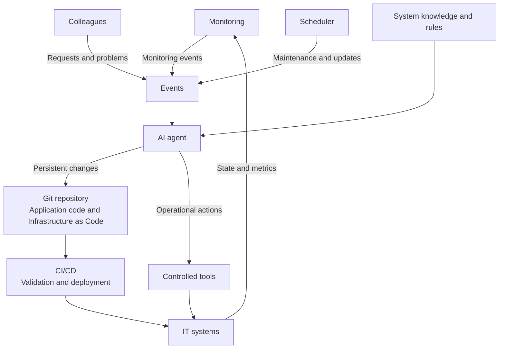
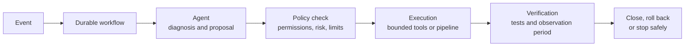

# AI-Operated Self-Hosting

Working title. Starting point for the hackathon platform team: AI agents take over
the routine operation of self-hosted applications, so that building our own tools
becomes cheaper than paying for SaaS.

This README summarises the concept discussion up to 2026-10-30. Everything below
is a proposal; nothing has been decided yet (see [Open decisions](#open-decisions)).
What we can use is listed under [Available resources](#available-resources).

## Problem

As an IT consultancy we build a lot with AI and could build many of the SaaS tools
we pay for ourselves, often better tailored to how we work. We still buy SaaS,
because running self-hosted software (monitoring, updates, backups, incidents) is
not worth the effort or nobody wants to own it.

Pitch storyline (60 seconds):

> We can build it → operations hold us back → AI takes over routine operations →
> building our own becomes economical.

## Idea

AI agents operate self-hosted applications. They react to three kinds of events
(monitoring alerts, reports from colleagues, scheduled maintenance) and act on the
systems through two paths:

- **Persistent changes** go through Git, Infrastructure as Code and CI/CD.
- **Immediate operational actions** (read logs, restart, scale) go through a small
  set of controlled tools.

Monitoring closes the loop and shows whether the systems work as expected afterwards.

| Concept | Role |
|---|---|
| Events | Single entry point for monitoring alerts, reports from colleagues and scheduled tasks |
| AI agent | Diagnoses the situation and decides what should happen |
| System knowledge and rules | System inventory, runbooks, past incidents and autonomy rules |
| Git repository + IaC | Versioned desired state of applications and infrastructure |
| CI/CD | Validates, tests and rolls out persistent changes |
| Controlled tools | Narrow, immediate actions, e.g. "read logs of service X", "activate known revision", "scale within limits" |
| Monitoring | Feedback on whether the systems work as expected |

**Target for a pilot:** run one self-hosted business application (working assumption:
a CRM) with as little human intervention as possible.

**Limit:** a guarantee that no human is ever needed for any failure is not realistic.
The system must recognise when to stop making changes, keep the incident open and
escalate.

## Design principles

1. **The agent plans, a deterministic workflow executes.** Retries, permissions and
   rollbacks must not depend on the model remembering them in the next step.
2. **Persistent changes go through Git and CI/CD.** Immediate operational fixes are
   reflected in the repository afterwards.
3. **Least privilege.** The diagnosis agent mostly reads. Write actions run under
   separate identities with narrow permissions. Permission checks live in the tool
   or the service that executes it, not in the prompt.
4. **Input is data, not instructions.** Tickets, logs and release notes never
   override operating rules.
5. **No self-escalation.** The agent cannot extend its own permissions or approve
   changes to its own control rules. Agent configuration and rules are versioned too.
6. **Operations run separately from the application.** If the application fails,
   intake, queue and remediation keep working. Known, hard-coded runbooks keep
   working when the model is unavailable. An independent external availability
   check and an emergency path cover a full cloud or identity outage.
7. **Safe execution.** Every action is protected against duplicate execution;
   changes are serialised per application.

## Reference architecture on Azure

The application is self-hosted, but built on managed Azure services wherever
possible: we keep control over application, configuration and data and avoid most
server maintenance.

| Task | Proposed Azure service | Purpose |
|---|---|---|
| Web application and API | Azure Container Apps | Run containers without operating a Kubernetes cluster |
| Background processing | Container Apps; Container Apps Jobs for finite tasks | Queues, imports, scheduled or event-driven tasks |
| Database | Azure Database for PostgreSQL Flexible Server (if the application supports it) | Managed database with maintenance and restore |
| Files | Blob Storage via the application API, alternatively Azure Files | Durable attachments; the container file system is ephemeral |
| Monitoring | Azure Monitor, Application Insights, Log Analytics | Availability, errors, latency and logs in one place |
| Intake channel | Teams app or support portal with Entra sign-in | Report problems, answer follow-up questions, see status |
| Event processing | Azure Functions + Service Bus | Normalise, buffer and hand over events |
| Operations workflows | Durable Functions | Multi-step runs with persisted state and retries |
| Agent | Microsoft Foundry Agent Service (functions, OpenAPI, MCP tools), using the existing Azure OpenAI deployment or Claude | Diagnosis and tool selection |
| Changes | Azure Repos, Azure Pipelines, Container Registry, Bicep | Reproducible builds and rollouts of infrastructure and applications |
| Access control | Entra ID, Managed Identities, Key Vault | Separate permissions and controlled access to secrets |

Monitoring alerts reach the event pipeline via Azure Monitor action groups, which
trigger a Function or Logic App that puts the event on Service Bus. Reports from
colleagues use the same entry point; the agent asks follow-up questions, identifies
the affected service and groups related reports into one incident. The reporter's
identity determines what they may see and request.

### Monitoring: three perspectives

An application can return HTTP 200 while nobody can save a contact. Uptime alone
is not enough.

| Perspective | What is checked |
|---|---|
| Technical | Availability, latency, error rate, database connections, background job backlog |
| Functional | A dedicated test user signs in, creates a test record, reads it back and deletes it |
| Operational | Backups current, restore drills successful, certificates valid, the automation itself reachable |

Simple availability checks: Application Insights standard tests. Functional checks:
own test jobs on a schedule.

### Autonomy rules (proposal)

Approval for known cases is encoded in the rules, so not every action needs a human.

| Action | Proposed rule |
|---|---|
| Diagnosis and tests | Automatic, within the permitted data access |
| Restart or scaling | Automatic, with upper limits and back-off between attempts |
| Switch to a known application version | Automatic, if database compatibility is proven |
| Application update | Automatic, after a successful test and release pipeline |
| Data restore or irreversible migration | Only through a predefined, tested runbook |
| Unknown failure without a safe fix | Stop changes, keep the incident open, escalate |

### Example incident

1. After a deployment, errors when saving contacts increase.
2. The workflow opens an incident and collects logs, metrics, the last change and
   matching runbooks.
3. The agent proposes switching back to the previous application version.
4. The policy check verifies that this version is compatible with the current
   database schema and that no other remediation is running.
5. A bounded tool shifts traffic back.
6. Independent tests check sign-in, read and write. Only after an observation
   period does the workflow close the incident and inform the people affected.

### Updates and data

- **Update pipeline:** a schedule looks for new versions and security fixes, the
  agent assesses release notes and dependencies, the pipeline builds a pinned image,
  scans it for vulnerabilities and deploys a test environment. Functional tests and
  migrations run there first; production follows with defined abort criteria.
  Container Apps traffic splitting allows a gradual rollout, but only if old and
  new version can work on the same data at the same time.
- **The database is the hard part.** Restarting an old container does not undo a
  data migration. Prefer backwards-compatible schema changes and treat irreversible
  ones separately. Background jobs and external side effects (e.g. emails already
  sent) need their own rules.
- **Managed PostgreSQL:** Azure applies minor version updates during maintenance;
  major versions remain planned, tested changes. A restore creates a new server;
  verifying it and switching over must be part of the runbook.
- **Backups alone are not enough.** Run regular isolated restores including an
  application test and measure actual data loss and downtime against limits agreed
  in advance.

## Existing products

Research as of 2026-09-27, based on public documentation only. No product was
tested and the findings have not been re-verified since.

| Product | What already fits the concept | What we would still build or configure |
|---|---|---|
| Azure SRE Agent | Connects Azure monitoring, incidents, source code and operational knowledge. Scheduled tasks, Teams integration, automatic actions within defined permissions | Application-specific tests, update pipelines, restore runbooks, allowed actions. CI/CD and IaC stay connected components |
| Resolve AI | Agents for alert handling, root cause analysis and recurring operational tasks. Documents actions such as pull requests, commit reverts and triggering GitHub workflows | Connect existing infrastructure and tools; define maintenance and deployment runbooks |
| Kubiya | Platform for agents and executable runbooks. Schedules, webhooks, Terraform tools, own workflows for build, test and deploy | Configure agents, tools, permissions and workflows. An automation platform rather than ready-made application operations |
| Harness | Broad platform with CI/CD, IaC management and AI SRE. Links incidents to changes and can trigger runbooks or pipelines | Connect modules and runbooks. The IaC remediation agent was beta on request, started manually and produced a pull request rather than fixing infrastructure itself |

Notes from the research:

- Azure SRE Agent was reported generally available since 2026-03-10 and is the
  closest match for an Azure setup. It can either propose actions for review or
  execute them itself, and hand findings to GitHub Copilot for code fixes. That is
  not the same as an automatically tested and rolled-out fix.
- Resolve AI is the stronger candidate for multi-cloud and mixed tooling. A listed
  integration (Azure, Azure DevOps, Terraform, Teams) shows connectivity, not
  every required write or automation path.
- No product was found that takes an arbitrary CRM and reliably handles updates,
  migrations, backups and all incidents without humans.

Candidate stack with less custom development: **Azure SRE Agent + Azure Monitor +
GitHub or Azure DevOps + CI/CD + Bicep or Terraform**, with the application still
running in our own Azure environment.

## Available resources

Provided for the hackathon on 2026-10-30; more can be requested if needed.

| Resource | Details |
|---|---|
| Azure subscription | `e74d4729-d5f5-4fd4-ab22-17005555593e` in tenant `mmkdigital.io` ([resource groups in the portal](https://portal.azure.com/#@mmkdigital.io/resource/subscriptions/e74d4729-d5f5-4fd4-ab22-17005555593e/resourceGroups)) |
| Azure OpenAI | Existing deployment with several current GPT models in this subscription. Deployment names, region and quotas not inventoried yet |
| Anthropic API | Roughly 400 USD per month |

### Credentials

Decided on 2026-10-30 for this repository: credentials never go into Git, even
though the repository is private.

- Local work: copy `.env.example` to `.env` and fill in the values. `.env` is
  ignored by Git.
- Services running in Azure: Key Vault and Managed Identities.

## Proposed pilot scope

- One application, one environment.
- Automate first: restart, bounded scaling, deployment rollback, tested updates and
  restore drills.
- Product comparison: give Azure SRE Agent and Resolve AI the same task. A new
  application version causes errors; the system must find the cause, apply a
  remedy and then pass a functional test. Plus one scheduled update run.
- Metrics: successful remediations, wrong actions, repeat failures, time to
  recovery, remaining manual interventions.
- Expected main effort: good application tests and tested runbooks. Once these
  exist, day-to-day operations shrink considerably.

Out of scope for now: the rest of an IT department (devices, identities, access
decisions, organisational tasks), which needs its own automation rules.

## Open decisions

- Which application do we run in the pilot? "CM" was interpreted as CRM; a CMS
  would have a similar setup.
- Buy or build the agent layer: Azure SRE Agent or Resolve AI versus a custom
  setup on Foundry Agent Service and Durable Functions.
- GitHub or Azure DevOps; Bicep or Terraform.
- Autonomy limits and acceptable data loss and downtime per application.
- Model for the agent: the existing Azure OpenAI deployment, Claude via the
  Anthropic API (about 400 USD per month), or both.
- Cost guardrails: Azure SRE Agent and other managed services are billed to the
  subscription; their pricing has not been checked yet. An agent running in a loop
  can use up the monthly Anthropic budget, so cost per run needs a limit.

## Sources

Named in the original research; links still need to be added when re-verifying.

- Microsoft Learn: Jobs in Azure Container Apps; storage in Azure Container Apps;
  traffic splitting in Azure Container Apps
- Microsoft Learn: Application Insights availability tests; Azure Monitor action
  groups; Durable Functions overview; Foundry Agent Service
- Microsoft Learn: Azure Database for PostgreSQL Flexible Server version policy and
  backup/restore
- Azure SRE Agent documentation and Microsoft's general availability announcement
- Resolve AI documentation and integration list
- Kubiya workflows and background jobs documentation
- Harness AI SRE documentation
