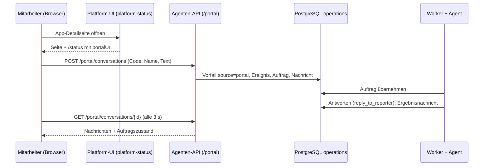

# Design: Mitarbeiter-Chat

## Ablauf

## Entscheidungen

1. **Endpunkte in der Agenten-API, nicht im Statusdienst.** Annahme und Speicherung von Ereignissen gehören zu C's API (transaktional, dedupliziert). Der Statusdienst `platform-status` bleibt serverseitig lesend; der Browser ruft `https://operations-agent.<baseDomain>/portal/…` per CORS auf. Erlaubte Ursprünge: `https://platform-status.<baseDomain>` und der eigene Host (die Agenten-API liefert dieselbe UI aus).
2. **Zugangscode statt Login.** Tabelle `portal_access_codes` mit SHA-256-Hash, Bezeichnung, Ablauf, Widerruf. Der Code geht als Kopfzeile `X-Portal-Code` mit; der Browser hält ihn in `localStorage`. Ein falscher Code liefert 401 ohne Hinweis, ob er existiert. Ratenbegrenzung pro Code: höchstens 20 Nachrichten in 10 Minuten (429).
3. **Unterhaltung = Vorfall.** `incident_key` = Unterhaltungs-ID (UUID), Quelle `portal`. Jede Nachricht ist ein Ereignis (`deliveryId` = Nachrichten-ID vom Client, idempotent), `eventType` `chat-message`. Läuft der Auftrag noch, hängt sich die Nachricht an; ist er abgeschlossen, entsteht ein neuer Auftrag im selben Vorfall (wie bei Issue-Kommentaren).
4. **Nachrichten getrennt von Ereignissen.** Tabelle `conversation_messages` (Rolle `reporter`, `agent`, `system`; Autor; Text höchstens 4000 Zeichen; Auftrag; Zeitpunkt). Ereignisse bleiben unveränderte Eingänge; der Verlauf für die UI liest nur diese Tabelle.
5. **Agentenkontext.** `ContextRefs.conversation` (`id`, `reporter`) und der bisherige Verlauf als `issue_text` (Daten, höchstens 4000 Zeichen). Neuer Dienst `OperationsServices.conversation.post(job_id, text, kind)` mit `kind` `reply` oder `result`, geprüft gegen den Auftragsbesitz.
6. **Antworten des Agenten.** Werkzeug `reply_to_reporter(text)` für Rückfragen und Zwischenstände; der Runner postet nach dem Lauf das Ergebnis (`resolved` / `needs_attention` / `failed` mit Begründung und bestätigten Befunden), genau einmal je Auftrag. Zustandswechsel des Auftrags erscheinen in der UI als Systemzeilen aus der Auftragstabelle, nicht als gespeicherte Nachrichten.
7. **Wünsche sind keine Befehle.** Der Text bleibt Daten (E6/Prompt-Trennung). Ein gewünschter Neustart ist zulässig, wenn der Katalog `restart` erlaubt und der Agent dies mit Befund begründet; sonst erklärt er im Chat, warum nicht.

## Risiken

- Ein weitergegebener Code erlaubt jedem, Läufe auszulösen: widerrufbar, ratenbegrenzt, Kosten pro Lauf begrenzt (5 USD).
- Die Seite ist öffentlich; Verläufe sind nur mit Code und Unterhaltungs-ID lesbar.
