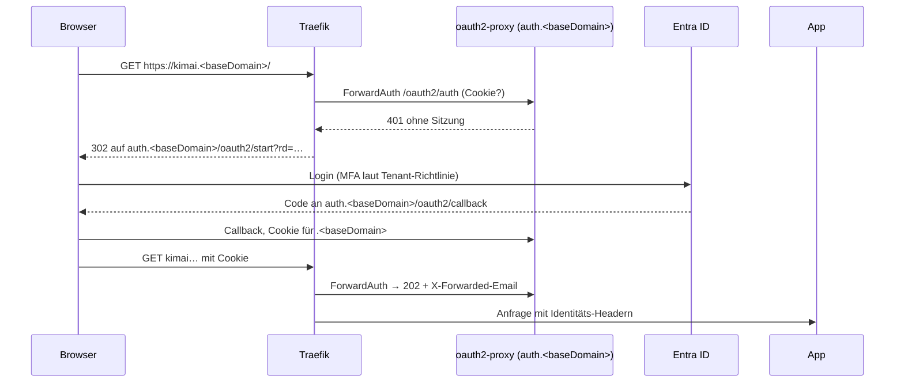

# Design: Entra-Login am Ingress

## Ablauf

## Entscheidungen

1. **oauth2-proxy statt App-eigener Logins.** Bewährt mit Traefik-ForwardAuth, kein Code in den Apps, ein Deployment für alle Hosts. Alternativen: Azure Application Gateway mit Entra (eigene, teure Ressource, ändert den Ingress-Pfad), Login in jeder App (nicht wartbar).
2. **Ein zentraler Callback-Host** `auth.<baseDomain>`. Damit reicht eine einzige Redirect-URI in der App-Registrierung, auch wenn neue Apps hinzukommen. Cookie-Domain `.<baseDomain>`; `sslip.io` steht nicht auf der Public Suffix List, die Domain-Cookies funktionieren also.
3. **Konfiguration in der Foundation.** oauth2-proxy und Middleware gehören zur gemeinsamen Ingress-Schicht (Strang A, `ingress.ts`); Client-ID, Tenant-ID als Konfiguration, Client-Secret und Cookie-Secret als Pulumi-Secrets. Schalter `entraLogin` (Standard aus), damit Stacks ohne App-Registrierung weiter laufen.
4. **App-Opt-in über den Katalog.** `ingress.auth: entra | none` (Standard im Schema: `none` für Bestandskompatibilität; das Gerüst setzt `entra`). `ingress.publicPaths` erzeugt eine zweite Ingress-Regel ohne Middleware für genau diese Pfade.
5. **Maschinenpfade.** Agenten-API: `/healthz`, `/events/` bleiben öffentlich (eigene Authentifizierung per Schlüssel bzw. Signatur). Smoke-Tests und Gesundheitscheck prüfen den Prüfpfad, der damit in `publicPaths` stehen muss; die Validierung erzwingt, dass `availability.path` bei `auth: entra` öffentlich ist.
6. **Chat-Identität.** Ist die Plattform-UI geschützt, ruft der Browser die Chat-API auf demselben Ingress mit Cookie auf (`credentials: include`); Traefik ergänzt `X-Forwarded-Email`. Die API vertraut diesen Headern nur, wenn sie über den Ingress mit Middleware kamen (Shared Secret-Header, den die Middleware setzt). Der Melder-Name kommt dann aus der Identität; der Zugangscode wird optional.
7. **Gruppen.** `allowedGroups` (Objekt-IDs) in der Foundation-Konfiguration; leer bedeutet: jedes Konto des Tenants.

## Voraussetzungen und Abweichungen

- **Entra-App-Registrierung** (Abweichung von E3): Redirect-URI `https://auth.<baseDomain>/oauth2/callback`, Scopes `openid email profile`, optional Gruppen-Claim. Anlegen durch einen Tenant-Admin oder eine Person mit dem Recht „Anwendungen registrieren“; Owner der Subscription reicht nicht.
- **Änderung der baseDomain** (Ingress-IP neu): Redirect-URI in der Registrierung anpassen; steht in der Wiederherstellungsanleitung.

## Risiken

- Fällt oauth2-proxy aus, sind alle geschützten Apps nicht erreichbar: zwei Replicas, Readiness-Probe, Verfügbarkeitstest auf `auth.<baseDomain>/ping`.
- Header-Spoofing: Apps dürfen Identitäts-Header nur von Traefik annehmen; Traefik entfernt eingehende `X-Forwarded-*`-Header vor der Middleware.
- Doppelte Anmeldung bei Apps mit eigenem Login (AFFiNE): bewusst in Kauf genommen oder `auth: none`.
